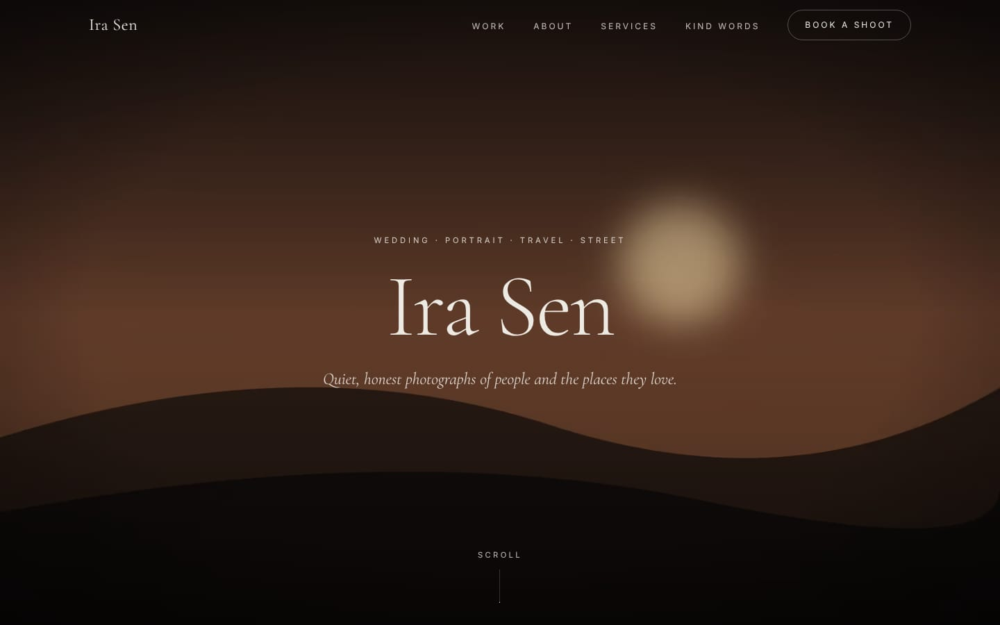
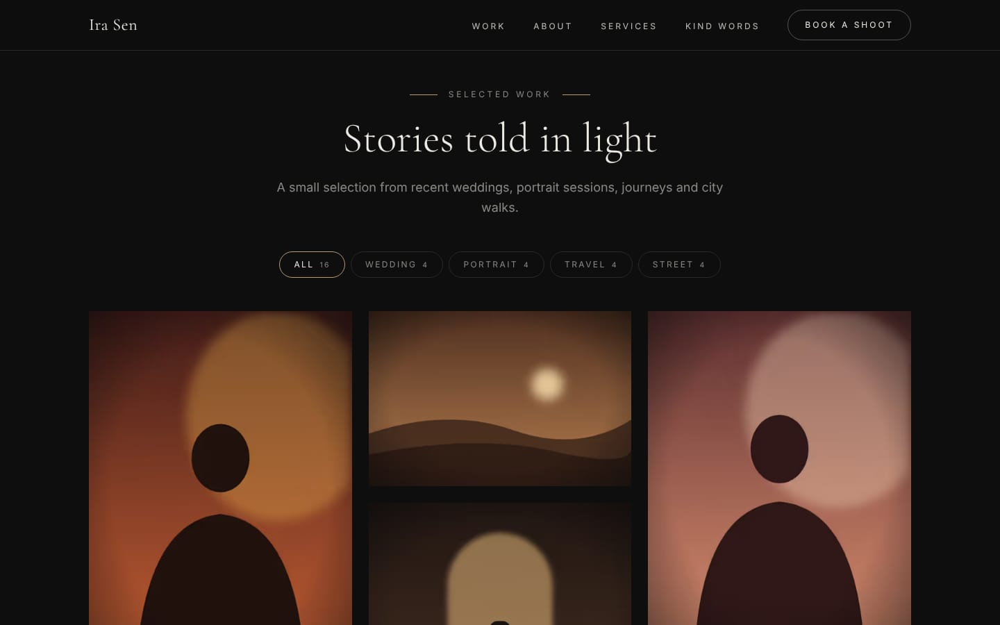
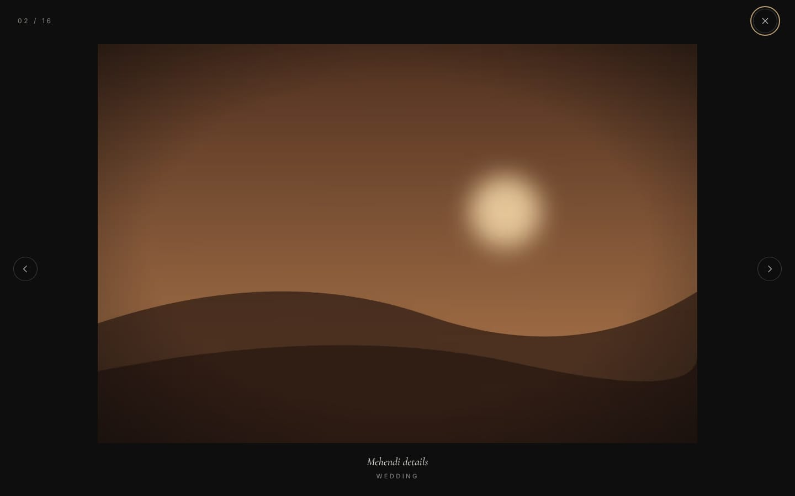
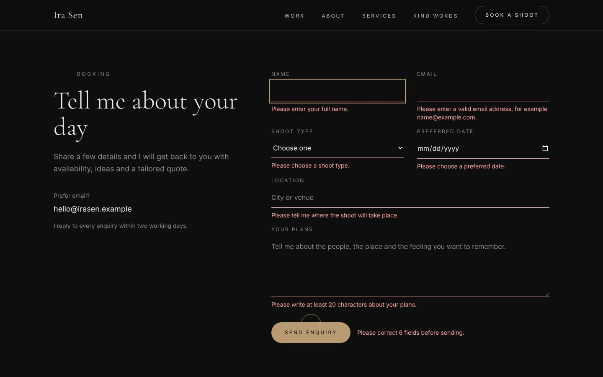
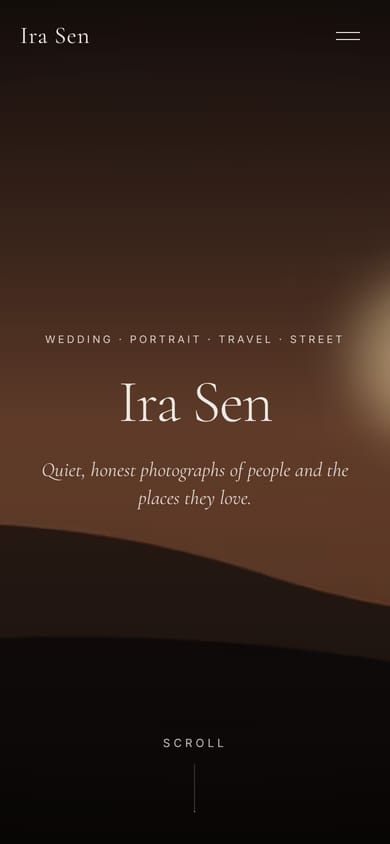

# Ira Sen Photography: Portfolio Website

An editorial, image-first portfolio website for **Ira Sen**, a fictional wedding, portrait and travel photographer based in Jaipur. Built as a fast, accessible static site and deployed on Netlify.

> Sample website for demonstration purposes. Ira Sen is a fictional person.

**Live demo:** https://ira-sen-photography.netlify.app



## Features

- **Full-screen hero** with a slow crossfade between photos (a single still photo when reduced motion is preferred)
- **Masonry gallery** with animated category filters (All, Wedding, Portrait, Travel, Street) using `aria-pressed` and a live region
- **Accessible lightbox** built on the native `<dialog>` element: arrow keys, Esc, swipe, focus trap, caption, counter, next/previous preloading and focus return to the clicked photo
- **Responsive images**: AVIF + WebP at several widths via `srcset`/`sizes`, explicit width/height (no layout shift) and a blurred placeholder while loading
- **Booking form** on Netlify Forms with client-side validation, inline errors, honeypot spam protection and a success message
- **About, Services and Testimonials** sections with scroll-reveal animations
- **Optional custom cursor** on desktop only (disabled on touch devices and with reduced motion)
- **SEO basics**: meta description, Open Graph tags, canonical URL, favicon, `robots.txt`, `sitemap.xml`
- **Custom 404 page** served automatically by Netlify
- **Performance**: self-hosted fonts, no UI or animation libraries, long-term caching for hashed assets and images

## Tech stack

| Area | Choice |
| --- | --- |
| UI | React 19 |
| Build tool | Vite 7 |
| Styling | Tailwind CSS v4 |
| Fonts | Cormorant Garamond + Inter (self-hosted via Fontsource) |
| Images | sharp (local build script) |
| Hosting and forms | Netlify (Netlify Forms) |

## Getting started

Requirements: Node.js 20.19 or newer.

```bash
npm install
npm run images   # optimize photos from images-src/ (see below)
npm run dev      # start the dev server at http://localhost:5173
```

Other scripts:

```bash
npm run build    # production build into dist/
npm run preview  # preview the production build locally
```

The booking form is simulated in development. It submits for real only on Netlify.

## Image workflow

1. Download the photos listed in `scripts/photos.json` from Unsplash (at least 2400 px wide for hero photos, 1800 px for gallery photos).
2. Save them in `images-src/` using the file names from `scripts/photos.json`.
3. Check `alt` and `caption` for each photo in `scripts/photos.json`.
4. Run `npm run images`.

The script creates AVIF and WebP files in `public/images/` (with content hashes in the file names), writes `src/data/images.generated.json`, generates `public/og-image.jpg` and `CREDITS.md`, and removes outdated files. Original photos in `images-src/` are not committed.

## Deployment (Netlify)

1. Push the repository to GitHub.
2. In Netlify, choose **Add new project → Import an existing project** and select the repository.
3. Netlify reads `netlify.toml`: build command `npm run build`, publish directory `dist`.
4. Enable form detection under **Project configuration → Forms**, then redeploy.
5. Replace the placeholder URL `https://ira-sen-photography.netlify.app` in `index.html`, `public/robots.txt` and `public/sitemap.xml` if your Netlify URL is different.

## Project structure

```
├── docs/                  # README screenshots
├── images-src/            # Original photos (git-ignored)
├── public/                # Static files copied as-is (favicon, robots, sitemap, optimized images)
├── scripts/
│   ├── optimize-images.mjs  # Image pipeline (sharp)
│   └── photos.json          # Photo list: file, usage, category, alt text, credits
├── src/
│   ├── components/        # Page sections and reusable UI
│   ├── data/              # Site content and generated image manifest
│   ├── hooks/             # Media query, scroll, scroll-lock and focus-trap hooks
│   ├── lib/               # Image URL and booking form helpers
│   ├── pages/             # 404 page
│   └── styles/            # Tailwind theme, global CSS and fonts
├── 404.html
├── index.html
├── netlify.toml
└── vite.config.js
```

## Screenshots

| Home | Gallery | Lightbox |
| --- | --- | --- |
|  |  |  |

| Booking form | Mobile |
| --- | --- |
|  |  |

## Accessibility

- Semantic landmarks, skip link and a logical heading order
- Visible focus states and keyboard support for every interaction
- Text contrast meets WCAG AA on the dark theme
- All motion respects `prefers-reduced-motion`

## Image credits

All photographs come from [Unsplash](https://unsplash.com/license). The full list of photographers is in [CREDITS.md](CREDITS.md), generated from `scripts/photos.json`.

## License

The code is free to use for learning purposes. The photographs belong to their respective photographers and fall under the Unsplash License.
